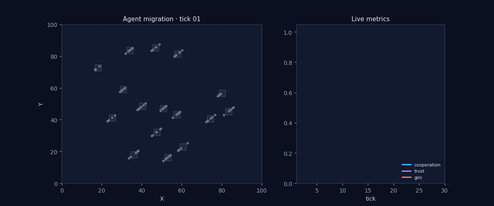
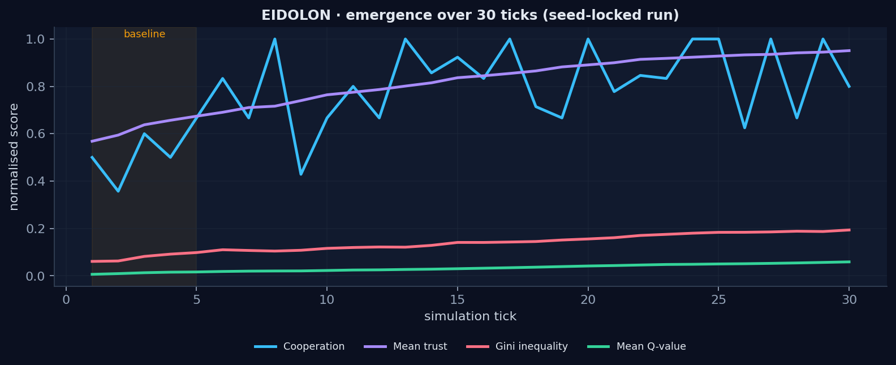
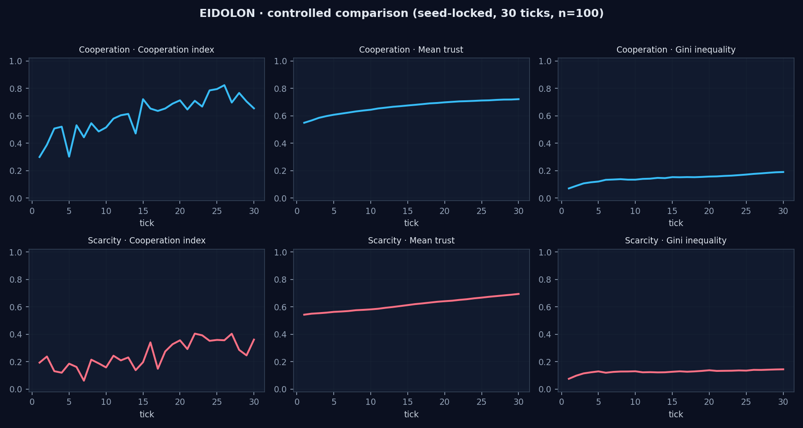
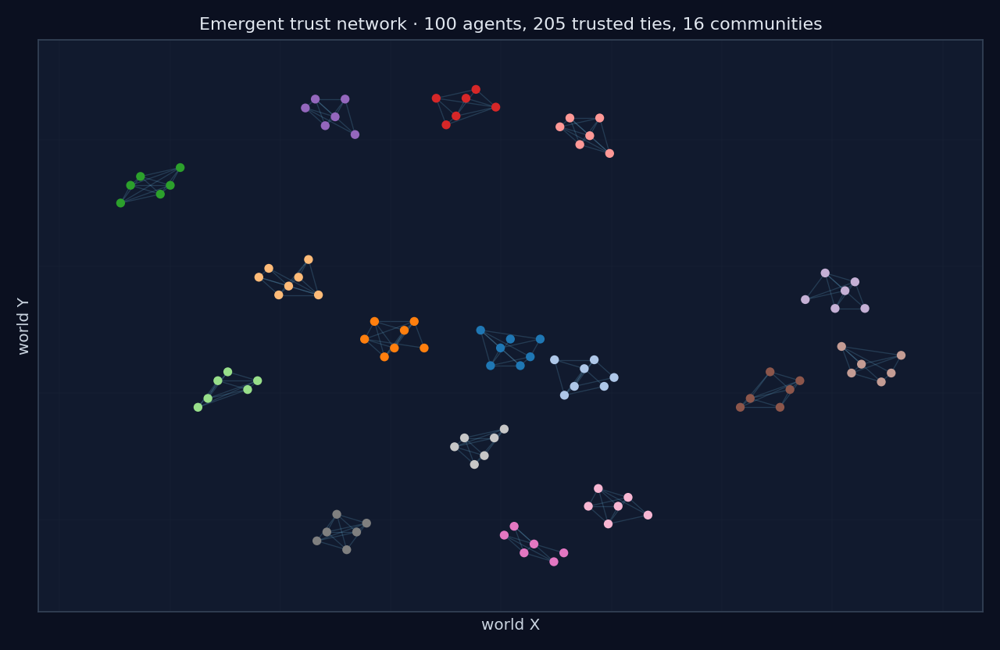
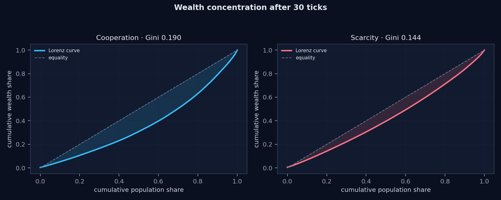
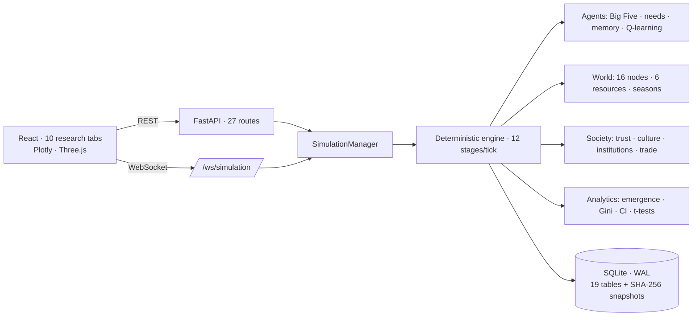
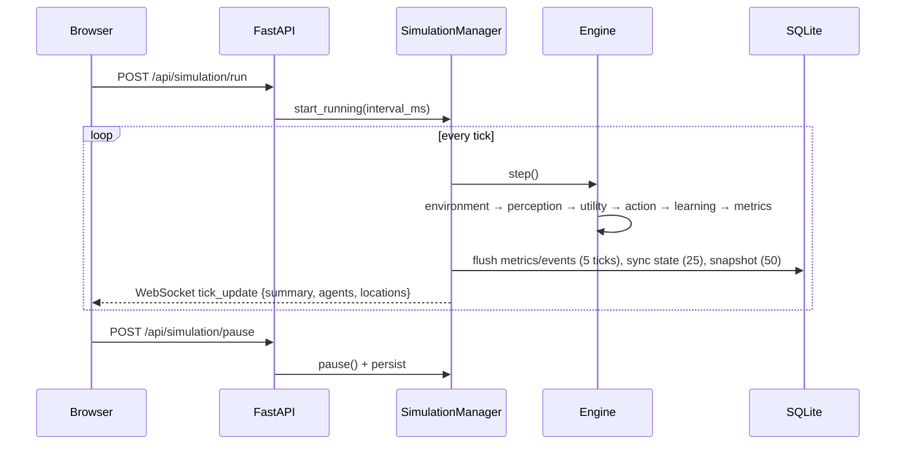
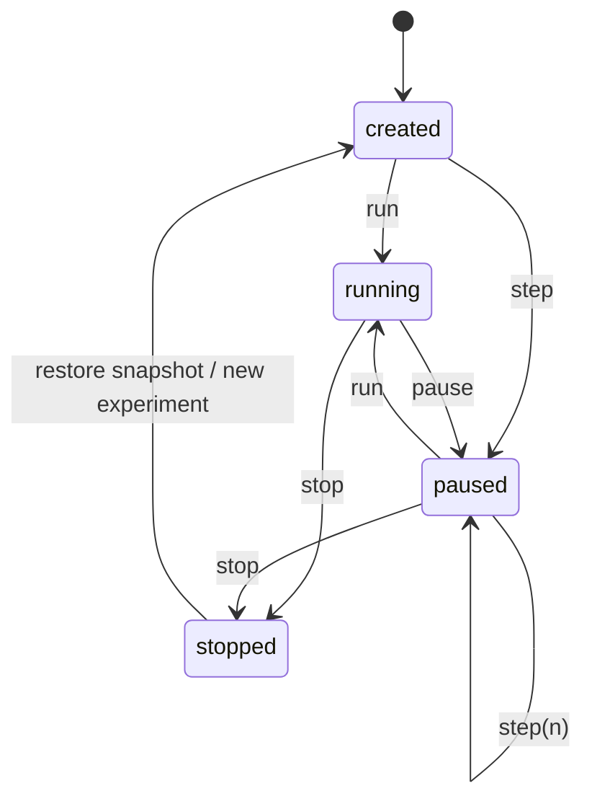
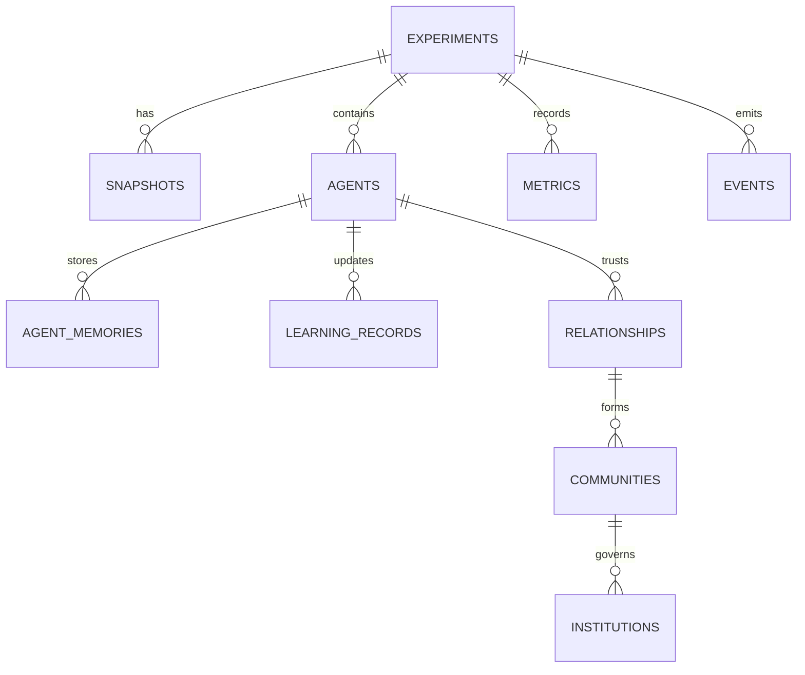

<div align="center">

# EIDOLON
### Autonomous Artificial Society & Computational Sociology Laboratory

**A deterministic, 100% offline artificial-life laboratory — no LLMs, no API keys, no cloud, no external inference.**


[](#) [](#) [](#) [](#) [](#) [](#) [](#-legal--restrictions)

> [!IMPORTANT]
> **© 2026 Satya Narayan Sahu. All rights reserved.**
> Viewing only. No copying, editing, forking, redistribution, or commercial use is permitted without express written permission. Public access on GitHub is **not** a licence. [Full terms](#-legal--restrictions).

</div>

---

## Run in 30 seconds

```bash
chmod +x install.sh eidolon.sh && ./install.sh   # venv + pinned deps + UI build
./eidolon.sh                                     # API + WS + UI → http://127.0.0.1:8000
# EIDOLON_PORT=8001 ./eidolon.sh                 # if port 8000 is busy
```

Open `/docs` for the interactive OpenAPI reference. Everything runs on localhost; unplug the network and it still works.

---

## Visual evidence

**Animated simulation** — agents migrating across the 16-node world while cooperation, trust and inequality evolve (30 seeded ticks):



| Live dashboard | Emergence trajectory | Controlled experiment |
|:---:|:---:|:---:|
|  |  |  |

| Emergent trust network | Wealth / Lorenz curves | Generated research report |
|:---:|:---:|:---:|
|  |  |  |

All figures are produced by the engine itself (`analytics/reports.py`) or from seed-locked engine traces — no stock photos, no external plotting service.

---

## Research thesis

**Thesis.** Complex social order — cooperation, trust clusters, norms, markets, institutions and inequality — can be generated from *local* agent cognition under resource constraints, without any external intelligence or pre-scripted social outcome, and can be measured reproducibly.

EIDOLON tests this by pairing a **from-scratch Agent Cognitive Architecture (ACA)** with a spatially explicit resource economy and an instrumented analytics layer. Every tick is deterministic: one seed ⇒ one trajectory ⇒ one snapshot checksum.

| # | Hypothesis | Operational measure | Observation (seed-locked 30-tick run) |
|---|---|---|---|
| **H1** | Synergy rewards and dense interaction stabilise cooperation | `cooperation_index` | Cooperation scenario: **0.299 → 0.654**; scarcity: **0.193 → 0.361** |
| **H2** | Asymmetric trust (fast decay) sorts the network into clusters | `mean_trust`, modularity communities | Trust rose **0.549 → 0.721** (cooperation); **205 trusted ties** and **16 communities** emerged |
| **H3** | Tabular Q-learning improves decisions without an LLM | `mean_q_value`, `mean_utility` | Q-value **0.006 → 0.113**; utility **0.427 → 0.459** |
| **H4** | Scarcity suppresses cooperation and lowers realised utility | cross-condition comparison | Scarcity ended at **0.361 cooperation** and **0.348 utility** vs **0.654 / 0.459** under synergy |
| **H5** | Inequality is measurable from inventories, not asserted | exact Gini, Lorenz curve | Gini **0.070 → 0.190** (cooperation) and **0.075 → 0.144** (scarcity) |

> These are illustrative 30-tick demonstrations, **not peer-reviewed findings**. Long runs, multi-seed paired t-tests and 95% confidence intervals are built into the platform so claims can be tested properly — see [Experiments](#experiments).

---

## Experiments

Eight parameterised scenarios, each with an explicit research question (from `backend/eidolon/scenarios/presets.py`):

| ID | Research question |
|---|---|
| `cooperation_experiment` | Under what payoff synergies and interaction rates do cooperative clusters and mutual-aid norms stabilise? |
| `scarcity_experiment` | How does acute scarcity shift competition, hoarding, inequality and mutual aid? |
| `cultural_transmission` | How do norms diffuse across spatial clusters and diverge between isolated communities? |
| `trust_experiment` | How does asymmetric trust sorting produce high-trust clusters vs rivalries? |
| `artificial_economy` | How do regional resource asymmetries drive crafting, trade, price discovery and Gini? |
| `institutional_formation` | When do repeated trusted interactions crystallise into councils, guilds, pools and academies? |
| `migration_experiment` | How do environmental shocks and depletion drive spatial migration? |
| `collective_intelligence` | How does distributed communication and social learning aggregate knowledge? |

### Protocol

```bash
# 1. launch two seeded conditions, 120 ticks each
curl -X POST localhost:8000/api/experiments -H 'Content-Type: application/json' \
  -d '{"scenario_id":"cooperation_experiment","seed":42,"duration_ticks":120}'
curl -X POST localhost:8000/api/experiments -H 'Content-Type: application/json' \
  -d '{"scenario_id":"scarcity_experiment","seed":108,"duration_ticks":120}'

# 2. step both via /api/simulation/select + /api/simulation/step, then compare
curl -X POST localhost:8000/api/analytics/compare -H 'Content-Type: application/json' \
  -d '{"mode":"controlled_trials","config_a":{"scenario_id":"cooperation_experiment"},
       "config_b":{"scenario_id":"scarcity_experiment"},"seeds":[42,108],"ticks":120}'

# 3. export JSON + CSV + PNG evidence bundle
curl -X POST localhost:8000/api/analytics/export -H 'Content-Type: application/json' -d '{}'
```

`run_controlled_comparison()` runs **paired multi-seed trials** and reports mean, variance, SD, t-based 95% CI, mean difference and paired t-test (`scipy.stats.ttest_rel`) for 11 core metrics. Snapshots store full RNG state, so any experiment can be resumed bit-for-bit.

---

## Architecture & flow control



**One tick, end to end** — the control flow behind the live dashboard:



**Run-state machine** (`/api/simulation/*`):



**Agent decision pipeline** — explainable, local and deterministic:

```mermaid
flowchart TD
    P[Perceive local stocks, neighbours, trust, hazard] --> R[Retrieve top-k episodic memories by cosine similarity]
    R --> U[Score 11 actions with weighted utility U(s,a)]
    U --> S{epsilon exploration?}
    S -- yes --> X[Explore novel feasible action]
    S -- no --> T[Softmax over top-3 actions, tau from conscientiousness]
    T --> A[Execute action: harvest / craft / trade / cooperate / migrate / ...]
    A --> L[Q-update + trust-weighted social learning + memory consolidation]
    L --> M[Emit event + metric row + human-readable explanation]
```

**Persistence model** (key tables of the 19-table schema):



---

## The world

```text
                                   NORTH ↑
   [Solar Terrace]   [Granite Ridge]   [Windspire Bastion]       Northern Highlands
   [Clearwater Spring]──[Verdant Bend]──[Atrium Archive]──[Timber Reach]  River Basin → East
        │                    │                │                   │
   [Reed Granary]────[Central Commons]──[Grand Bazaar]────[Sylvan Haven]  Central Plains
        │                 [Crossroads Gate]   │              [Forge Hollow]
   [Amber Quarry]──────[Dune Well]──────[Sunstone Camp]                  Southern Oasis
                                   SOUTH ↓
```

16 hand-authored locations across 5 regions, joined into a connected graph (MST + nearest-neighbour loops), with BFS `next_hop` routing, six regenerating resources, fertility/hazard profiles, seasonal multipliers and stochastic drought/bounty/storm/mineral-discovery events.

---

## Algorithms

| Subsystem | Mechanism |
|---|---|
| Decision | $$U(s,a)=0.34N+0.22E[R]+0.14P+0.14S+0.12A+0.10M+0.12G+0.06U_{unc}-0.18C-0.16\rho$$ |
| Selection | ε-guided exploration, else Boltzmann softmax over top-3 (τ from conscientiousness) |
| Learning | $$Q(s,a)\leftarrow Q(s,a)+\alpha[r+\gamma\max_{a'}Q(s',a')-Q(s,a)]$$; negative outcomes suppress bootstrapping and raise failure penalty |
| Memory | 4 layers; 5-D episodic vectors ranked by `0.45·cos + 0.18·loc + recency + emotion + relevance` |
| Trust | $$T_{ij}\leftarrow T_{ij}+\eta_+(1-T_{ij})$$ on cooperation; $$T_{ij}\leftarrow T_{ij}-\eta_-T_{ij}$$ on defection (η₋ > η₊) |
| Culture | Shannon entropy, norm adoption, inter-community L1 divergence; trust/payoff-weighted transmission |
| Economy | Smoothed supply/demand pricing; exact Gini $$G=\frac{\sum(2i-N-1)w_{(i)}}{N\sum w_i}$$ |
| Emergence | Windowed early-vs-recent deltas, greedy-modularity communities, centrality, 8 evidence-backed pattern objects |
| Statistics | Multi-seed paired trials, variance, 95% CI, paired t-tests |

Full derivation: [docs/mathematical_model.md](docs/mathematical_model.md).

---

## Code & API

**Headless engine** — no server needed:

```python
from eidolon.core.engine import ExperimentConfig, SimulationEngine

engine = SimulationEngine("demo", ExperimentConfig(seed=42, population_size=100))
for _ in range(30):
    engine.step()

m = engine.state_summary()["metrics"]
print(m["cooperation_index"], m["gini_coefficient"], m["community_count"])
```

**Live telemetry** — browser WebSocket:

```js
const ws = new WebSocket(`ws://${location.host}/ws/simulation`);
ws.onmessage = e => {
  const msg = JSON.parse(e.data);
  if (msg.type === "tick_update") console.log(msg.summary.metrics);
};
```

<details>
<summary><b>REST surface (27 routes, full list)</b></summary>

| Group | Endpoints |
|---|---|
| System | `GET /api/health` · `GET /api/diagnostics` · `GET /api/scenarios` |
| Experiments | `GET/POST /api/experiments` · `POST /api/experiments/import` · `POST /{id}/select` · `POST /{id}/duplicate` · `DELETE /{id}` |
| Simulation | `GET /api/simulation/state` · `POST /run` · `POST /pause` · `POST /stop` · `POST /step` · `PATCH /config` |
| Agents & society | `GET /api/agents` · `GET /api/agents/{id}` · `GET /api/social/network` |
| Analytics | `GET /api/analytics/metrics` · `GET /api/analytics/emergence` · `POST /api/analytics/compare` · `POST /api/analytics/export` · `GET /api/analytics/report/{filename}` |
| Persistence | `GET/POST /api/snapshots` · `POST /api/snapshots/{id}/restore` · `POST /api/backups` |
| Realtime | `WS /ws/simulation` |

</details>

---

## Verification & performance

```bash
PYTHONPATH=backend .venv/bin/python -m pytest -q   # 15 backend tests
npm --prefix frontend test                          # 3 frontend tests
npm --prefix frontend run build                     # tsc -b && vite build
npm --prefix frontend audit                         # 0 vulnerabilities
```

| Metric | Measured (30 ticks, 100 agents, Apple Silicon) |
|---|---|
| Mean tick latency | ~25 ms |
| Last tick latency | ~33 ms |
| Theoretical throughput | ~40 ticks/s |
| Toolchain | Python 3.12 · Vite 6.4.5 · Vitest 4.1.12 · postcss 8.5.33 |
| Dependency advisories | **0** (npm audit) |

Benchmark variants (100 / 500 / 1000 / 5000 agents): `PYTHONPATH=backend .venv/bin/python backend/tests/benchmark.py`.

<details>
<summary><b>Repository layout</b></summary>

```text
backend/eidolon/
  core/       clock, seeded RNG, event bus, engine, run manager
  agent/      cognition, models, learning, memory, reasoning
  world/      grid, resources, environment, economy
  social/     relationships, culture, institutions, communication
  analytics/  metrics, emergence, comparison, reports
  persistence/ SQLite database, repository, SQL migration
  api/        router (27 routes), schemas
  scenarios/  8 preset experiments
frontend/src/ App, 10 components, Zustand store, API client, types, tests
docs/         architecture, mathematical model, manual, developer guide, assets
data/         local SQLite DB, exported bundles, reports, backups (git-ignored)
```

</details>

Docs: [architecture](docs/architecture.md) · [mathematics](docs/mathematical_model.md) · [manual](docs/user_manual.md) · [developer](docs/developer_guide.md) · [offline install](docs/installation_offline.md) · [SBOM](SBOM.md)

---

## Limits & ethics

Graph mobility replaces continuous physics; seasons act uniformly per resource class; state-space is discretised for low-RAM hardware. The model is a **research simulator, not a social oracle**. Results are conditional on parameters and seeds; long horizons require multi-seed inference. No personal data, no network calls, no external AI — and no permission to reuse this work without the owner's written consent.

---

## Legal & restrictions

**Copyright © 2026 Satya Narayan Sahu. All rights reserved.**

This work — including source code, algorithms, models, configurations, documentation, data, charts, screenshots and every derived output — is proprietary. **Permission is granted to view this public repository for personal, non-commercial reference only.** No other licence, express or implied, is granted.

Without prior **express written permission** from the owner, it is strictly prohibited to:

- copy, clone, fork, mirror, host, publish or redistribute any part of this work;
- edit, adapt, translate, modify, build upon, or create derivative works;
- use it, directly or indirectly, for commercial purposes, products, services, research-for-hire, training datasets or teaching materials;
- remove or alter copyright notices, or claim authorship.

Unauthorised editing, reproduction or commercial exploitation infringes the owner's copyright and constitutes an offence; legal remedies will be pursued. Contact the owner through GitHub before any use beyond viewing. See [LICENSE](LICENSE).
