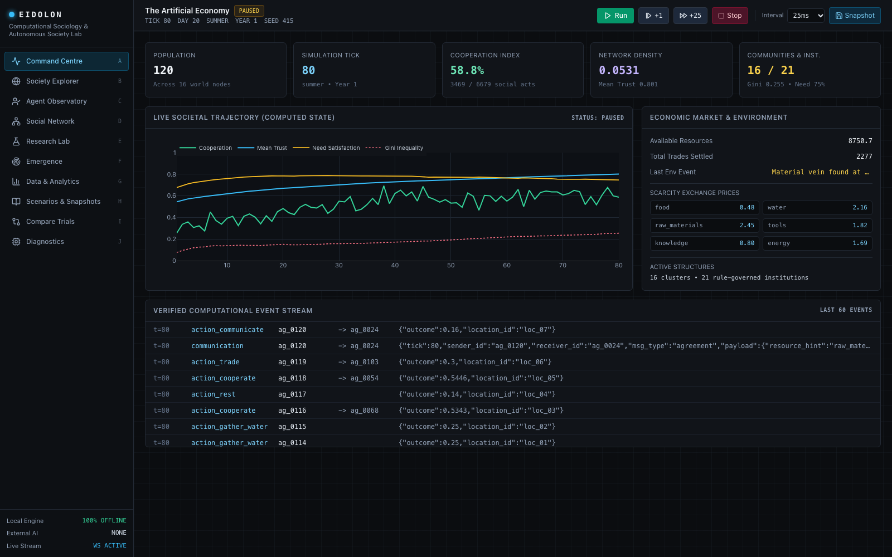
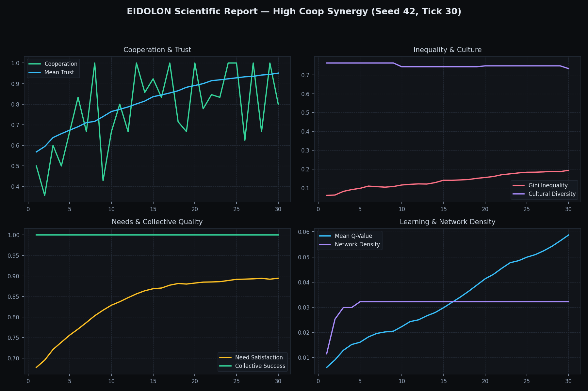
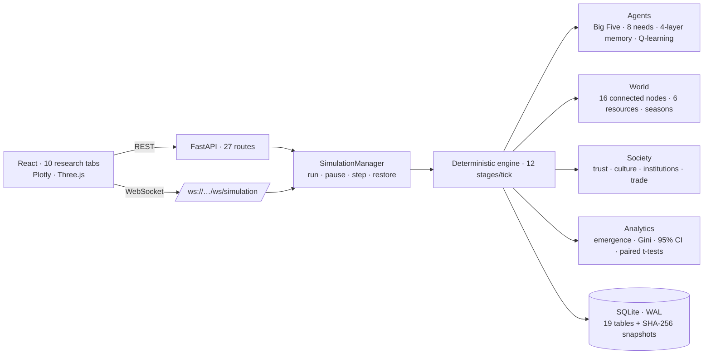

<div align="center">

# EIDOLON
### Autonomous Artificial Society & Computational Sociology Laboratory

**A deterministic, 100% offline artificial life lab — zero LLMs, zero API keys, zero cloud.**



[](#) [](#) [](#) [](#) [](#-legal--restrictions)

> [!IMPORTANT]
> **© 2026 Satya Narayan Sahu. All rights reserved.**
> Viewing only. No copying, editing, forking, redistribution, or commercial use is permitted without express written permission. Public access on GitHub is **not** a licence. [Full terms](#-legal--restrictions).

</div>

---

## Run it

```bash
chmod +x install.sh eidolon.sh && ./install.sh   # Python venv + npm deps + UI build
./eidolon.sh                                     # API + WebSocket + UI → http://127.0.0.1:8000
# EIDOLON_PORT=8001 ./eidolon.sh                 # if port 8000 is taken
```

## Evidence, not claims

| Live dashboard | Emergence over 30 ticks | Generated research report |
|:---:|:---:|:---:|
|  |  |  |

Seed-locked, reproducible metrics: cooperation, trust, Gini inequality and Q-values — exported to JSON/CSV/PNG by the analytics engine.

## Architecture



## The world

```text
                                   NORTH ↑
   [Solar Terrace]   [Granite Ridge]   [Windspire Bastion]       Northern Highlands
   [Clearwater Spring]──[Verdant Bend]──[Atrium Archive]──[Timber Reach]  River Basin → East
        │                    │                │                   │
   [Reed Granary]────[Central Commons]──[Grand Bazaar]────[Sylvan Haven]  Central Plains
        │                 [Crossroads Gate]   │              [Forge Hollow]
   [Amber Quarry]──────[Dune Well]──────[Sunstone Camp]                  Southern Oasis
                                   SOUTH ↓
```

16 routable locations across 5 regions; BFS navigation, seasonal regeneration, drought/storm events, scarcity pricing.

## 30-second code

```python
from eidolon.core.engine import ExperimentConfig, SimulationEngine

engine = SimulationEngine("demo", ExperimentConfig(seed=42, population_size=100))
for _ in range(30):
    engine.step()

m = engine.state_summary()["metrics"]
print(m["cooperation_index"], m["gini_coefficient"], m["community_count"])
```

| 100 agents | 16 locations | 8 scenarios | 27 API routes | 10 UI tabs | 18 passing tests |
|:--:|:--:|:--:|:--:|:--:|:--:|

Verify locally: `PYTHONPATH=backend .venv/bin/python -m pytest -q` · `npm --prefix frontend test` · `npm --prefix frontend run build`

Docs: [architecture](docs/architecture.md) · [mathematics](docs/mathematical_model.md) · [manual](docs/user_manual.md) · [developer](docs/developer_guide.md) · [offline install](docs/installation_offline.md) · [SBOM](SBOM.md)

---

## Legal & restrictions

**Copyright © 2026 Satya Narayan Sahu. All rights reserved.**

This work — including source code, algorithms, models, configurations, documentation, data, charts, screenshots and every derived output — is proprietary. **Permission is granted to view this public repository for personal, non-commercial reference only.** No other licence, express or implied, is granted.

Without prior **express written permission** from the owner, it is strictly prohibited to:

- copy, clone, fork, mirror, host, publish or redistribute any part of this work;
- edit, adapt, translate, modify, build upon, or create derivative works;
- use it, directly or indirectly, for commercial purposes, products, services, research-for-hire, training datasets or teaching materials;
- remove or alter copyright notices, or claim authorship.

Unauthorised editing, reproduction or commercial exploitation infringes the owner's copyright and constitutes an offence; legal remedies will be pursued. Contact the owner through GitHub before any use beyond viewing. See [LICENSE](LICENSE).
